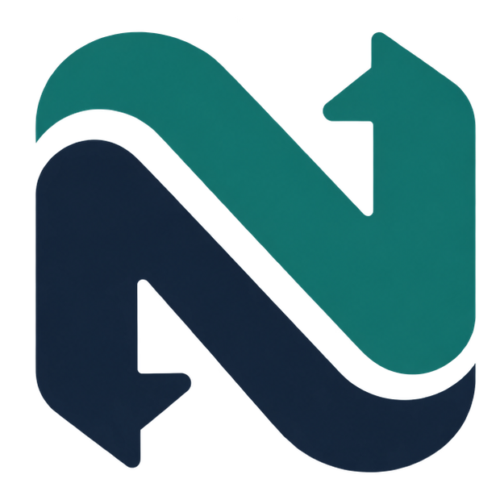
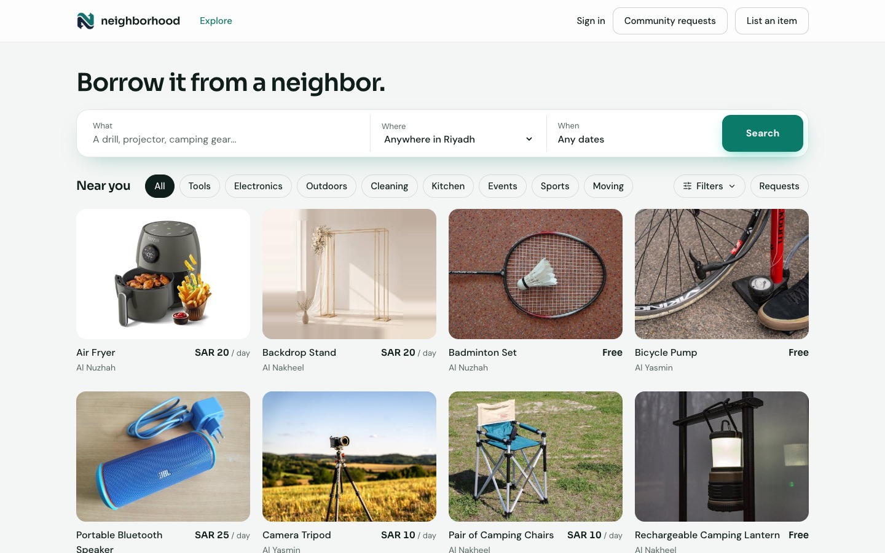
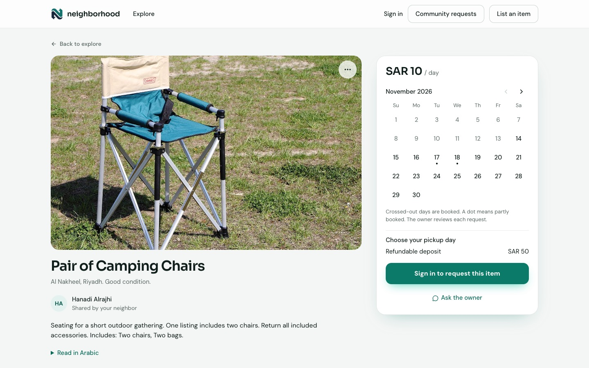
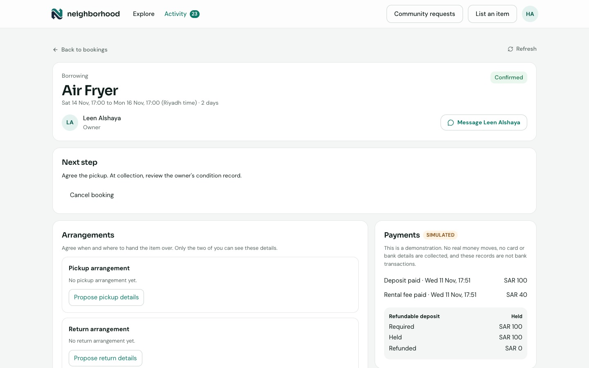
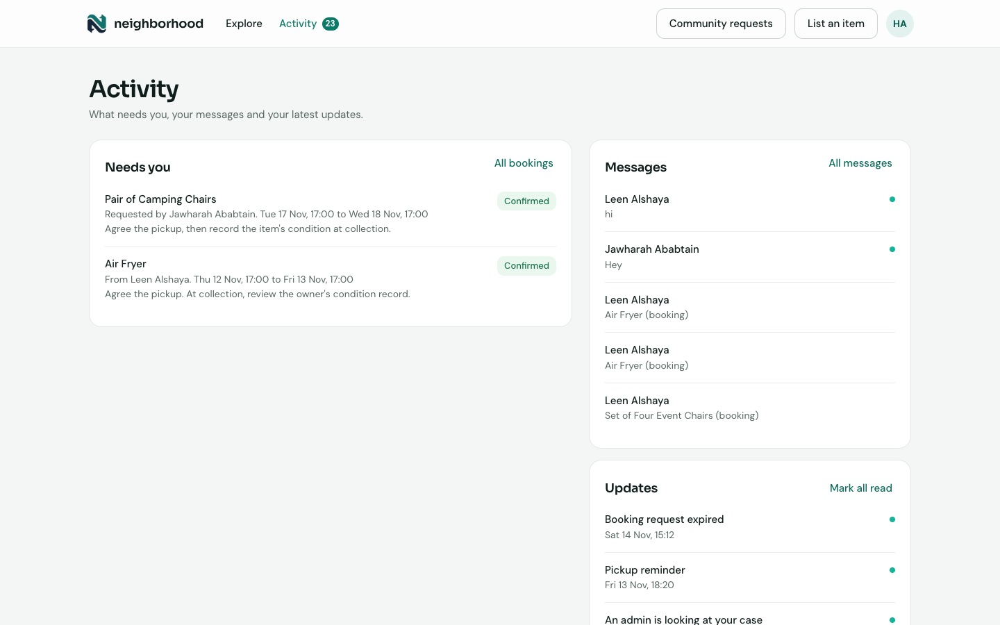
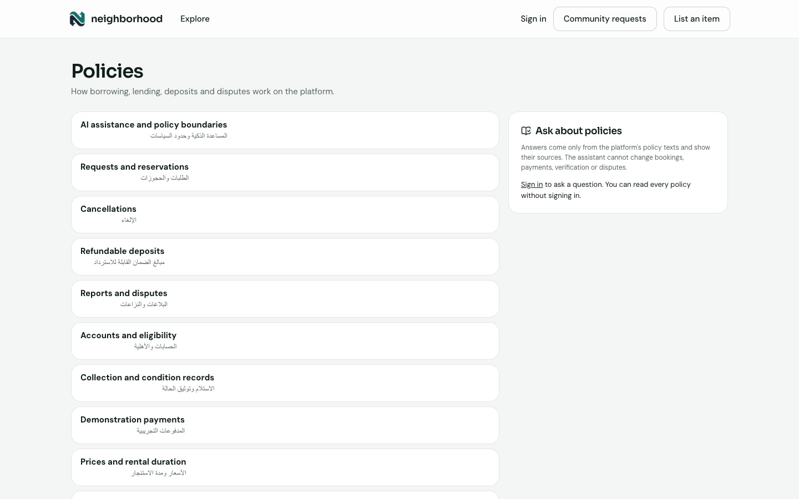
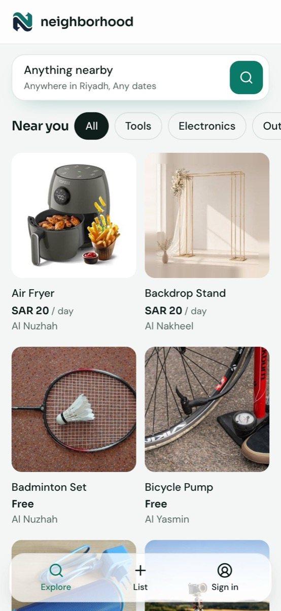

<p align="center">
  
</p>

<h1 align="center">Neighborhood Sharing and Rental Platform</h1>

<p align="center">
  Borrow it from a neighbor. Lend or rent the things you rarely use (tools, ladders,
  projectors, camping gear) to people who live nearby.
</p>

<p align="center">
  <a href="https://neighborhood-sharing.web.app"></a>
  <a href="https://github.com/222410415/neighborhood-sharing/actions/workflows/ci.yml"></a>
  <a href="LICENSE"></a>
</p>

<p align="center">
  
</p>

## About

Neighbors in Saudi Arabia lend or rent occasionally needed items, free or for a
daily fee in SAR, with a separate refundable deposit. The platform covers the
whole exchange: finding an item, requesting dates, paying, handing it over,
recording its condition, returning it, reviewing each other and resolving
disputes.

> Payments and deposits are **simulated**. No real money moves and no card or
> bank details are collected.

**Try it:** open the [live demo](https://neighborhood-sharing.web.app) and sign
in with `hanadi@neighborhood-demo.test` / `DemoPass123!`. The other demo members
are `leen@neighborhood-demo.test` and `jawharah@neighborhood-demo.test` (admin),
with the same password.

## Features

| Area | What it does |
| --- | --- |
| Accounts | Sign-up, sign-in, password reset, profiles, public member pages, verification (email plus demonstration checks) |
| Listings | Items with photos, daily price or free, deposit, condition, English and Arabic descriptions |
| Discovery | Search with category, neighborhood, date and price filters; related-item suggestions |
| Bookings | Availability calendar, booking requests, owner approval, cancellations, automatic expiry |
| Exchange | Simulated payment and deposit, pickup and return arrangements, condition records at collection and return |
| Communication | Messaging between members, an Activity hub and in-app notifications |
| Trust | Reviews, content reports, dispute cases with evidence |
| Community | Saved items with availability alerts, community requests and offers |
| Moderation | Admin workspace for disputes, reports, verification and moderation (warn, take down, suspend) with an audit trail |
| AI | Related-item suggestions and a policy assistant that cites its sources (OpenAI when configured, built-in fallbacks otherwise) |

## Screenshots

| Item page | Booking |
| --- | --- |
|  |  |
| **Activity hub** | **Policies and assistant** |
|  |  |

<p align="center">
  
</p>

## Tech stack

| Layer | Technology |
| --- | --- |
| Web | Next.js 16 (App Router), React 19, Tailwind CSS 4 |
| API | NestJS 12, TypeScript 5.9 |
| Shared contracts | Zod schemas, DTOs and booking rules used by both apps |
| Auth and data | Firebase Authentication, Cloud Firestore |
| Images | Sharp |
| Testing | Jest, Playwright, functional API checks |
| Tooling | pnpm workspace, ESLint, Prettier, GitHub Actions |
| Hosting | Docker, Google Cloud Run, Firebase Hosting |

```
Browser ── Firebase Auth SDK ──> Firebase Authentication
   │
   └── Next.js web (Cloud Run) ── /api/* ──> NestJS API /v1 (Cloud Run)
                                               ├── verifies Firebase ID tokens
                                               └── Firestore Admin SDK ──> Cloud Firestore
```

More detail is in [docs/architecture.md](docs/architecture.md).

## Project structure

```
apps/web            Next.js app: src/app (routes), src/features/<name>, src/components, src/lib
apps/api            NestJS API: src/modules/<name>, src/common, test/
packages/contracts  shared Zod schemas, DTOs and booking rules
infra/docker        production Dockerfiles (dev/ for local images)
infra/firebase      Firestore rules and indexes
infra/gcp           Cloud Build pipeline, setup and deploy scripts
scripts/            seed/, admin/, quality/
seed-data/          demo and reference data
tests/              functional API checks, Playwright browser checks
docs/               architecture, deployment, development, design system, decisions
```

## Run locally with Docker

Needs Docker Desktop (or Docker Engine with Compose v2) and an internet
connection. The first build downloads dependencies and takes several minutes.
The app uses a real Firebase project (Authentication and Firestore); there is
no offline database.

1. Get a Firebase service-account key (JSON) for the project from the team, or
   from Firebase console -> Project settings -> Service accounts. Keep it
   outside this folder and never share or commit it.
2. Create the settings file and point it at the key:
   ```sh
   cp .env.example .env
   # edit .env: FIREBASE_KEY_FILE=/absolute/path/to/key.json
   ```
3. Start the API (port 3001) and the website (port 3000):
   ```sh
   docker compose up -d --build --wait
   ```
4. Open http://127.0.0.1:3000 and sign in with one of the demo accounts above.
5. Stop it with `docker compose down`.

The project `neighborhood-sharing` is already seeded. For a new, empty Firebase
project, set `FIREBASE_PROJECT_ID` in `.env`, put that project's web config in
`apps/web/src/lib/firebase-client.ts`, then seed it once (see
[docs/development.md](docs/development.md), "Seed the real project"):

```sh
docker compose run --rm tools npx tsx scripts/seed/demo-data.ts
docker compose run --rm tools node scripts/seed/booking-settings.mjs
docker compose run --rm tools node scripts/seed/policies.mjs
docker compose run --rm tools node scripts/admin/grant-role.mjs --email jawharah@neighborhood-demo.test --role admin
```

AI features are optional: add `OPENAI_API_KEY` to `.env` to turn them on.
Without it, suggestions and the policy assistant use built-in fallbacks.

## Deploy to Google Cloud

```sh
PROJECT_ID=<id> bash infra/gcp/setup.sh     # one-time setup
PROJECT_ID=<id> bash infra/gcp/deploy.sh    # build and deploy API and web to Cloud Run
PROJECT_ID=<id> bash infra/gcp/hosting.sh   # https://<id>.web.app address
```

Full guide: [docs/deployment.md](docs/deployment.md).

## Checks

```sh
pnpm install --frozen-lockfile --ignore-scripts
pnpm lint && pnpm typecheck && pnpm test:unit && pnpm build
```

CI runs these on every push and pull request to `main`. Functional checks
(F-1 to F-72) and Playwright browser checks run against a running stack; see
[docs/development.md](docs/development.md).

## Documentation

| Document | Contents |
| --- | --- |
| [Architecture](docs/architecture.md) | Components, API surface, security model, Firestore collections |
| [Development](docs/development.md) | Local setup, seeding, running every check |
| [Deployment](docs/deployment.md) | Google Cloud and Firebase setup, deploy, operating notes |
| [Interface guide](docs/design-system.md) | Interaction, layout and workflow patterns |
| [Decisions](docs/decisions.md) | 44 recorded architecture and product decisions (D-01 to D-44) |

## License

[MIT](LICENSE)
